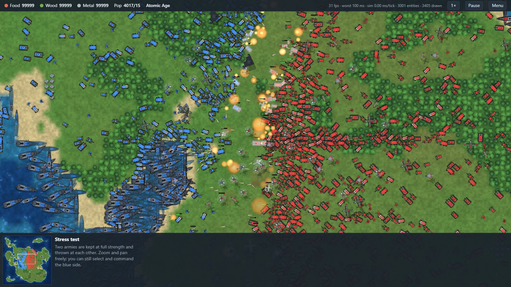
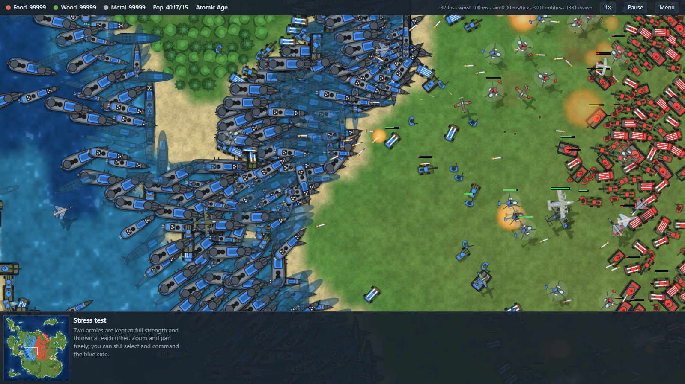

# OpenEpoch

**A free, open-source real-time strategy game spanning six epochs — from clubmen to nuclear submarines — that runs in your browser.**
The whole simulation is written in Rust and compiled to a 140 KB WebAssembly module with zero dependencies; rendering is a single instanced WebGL2 draw call.

### ▶ [Play it now](https://lukashold.github.io/openepoch/) &nbsp;·&nbsp; [Stress test: 4 000 units](https://lukashold.github.io/openepoch/?bench=2000)




## Why

Epoch-spanning RTS games of the early 2000s were wonderful, but big late-game battles — fleets, submarines, air wings — tended to stutter no matter how fast the PC was. OpenEpoch is a from-scratch take on that genre built around one goal: **thousands of units with flat frame times.**

Measured on the built-in stress test (`node tools/smoke.mjs`, one desktop core):

| Entities | Simulation cost per tick (20 ticks/s) |
|---------:|--------------------------------------:|
| 2 000 | ~0.9 ms |
| 4 000 | ~2.5 ms |
| 7 000 | ~6.3 ms |

How it stays smooth:

- **Fixed 20 Hz simulation, interpolated rendering.** The display rate never drives game logic, and a slow frame drops time instead of spiralling.
- **Shared flow fields instead of per-unit pathfinding.** A move order runs one BFS over the map; every unit heading there reads the same field. 500 units cost the same as 5.
- **No allocation in the tick.** Rust, fixed pools, no garbage collector — nothing to pause.
- **Uniform spatial grid** rebuilt by counting sort each tick for collision, targeting and splash damage; target searches are staggered across ticks.
- **One draw call.** Rust writes a flat instance buffer straight into WASM memory, JavaScript hands it to the GPU. No per-object JS calls.

## The game

- **Six epochs:** Stone Age → Bronze Age → Middle Ages → Industrial Age → Modern Age → Atomic Age
- **42 units and buildings** across land, sea, air and underwater
- **Submarines** are invisible until a detector (destroyer, cruiser, gunship, tower, another sub) is nearby or they fire. **Nuclear submarines** torpedo ships and launch cruise missiles at targets far inland.
- **Aircraft** really fly: fixed-wing planes can't stop, make strafing and bombing runs, and loiter in circles; helicopters hover and hunt subs.
- **Economy:** food, wood, metal; workers gather, build, and go back to work afterwards; farms give endless food.
- **Fog of war**, minimap, control groups, attack-move, rally points, production queues, formations.
- **AI opponents** (1–3) that build an economy, advance through the epochs and attack in waves.
- **Procedural maps** from a seed — continents, lakes, forests, ore fields.

### Controls

| Input | Action |
|---|---|
| Left click / drag | Select · double-click selects all of a type · Shift adds |
| Right click | Move · attack · gather · build · set rally point |
| `A` + click | Attack-move |
| `S` / `Del` | Stop / destroy selected |
| Arrow keys, screen edge, middle-drag | Scroll |
| Mouse wheel | Zoom |
| `Q W E R T` / `Z X C V B` | Command buttons |
| `Ctrl+1…9` / `1…9` | Set / recall control group (tap twice to jump) |
| `F` · `H` · `Space` | Idle worker · home · jump to selection |
| `P` · `+` · `-` | Pause · game speed |

## Build from source

```sh
rustup target add wasm32-unknown-unknown
./build.sh            # or .\build.ps1 on Windows
python -m http.server --directory docs 8123
```

Then open <http://localhost:8123>. No bundler, no npm install, no wasm-bindgen.

```
src/defs.rs     unit & building data
src/map.rs      map generation, passability, flow fields
src/game.rs     entities, orders, movement, combat, economy
src/ai.rs       scripted opponent
src/render.rs   instance buffer, minimap, HUD state
src/lib.rs      C-ABI exports called from the page
docs/           the page: WebGL2 renderer, input, HUD, procedural sprite atlas
tools/          headless smoke test and benchmark (Node)
```

URL parameters: `?seed=42` starts a skirmish on that map, `?ai=3` sets opponents, `?bench=2000` starts the stress test with 2 000 units per side.

## Status and roadmap

Playable skirmish against AI. Not there yet: sound, multiplayer, saved games, territories/provinces, technologies beyond epoch advances, unit upgrades between epochs, touch controls, transport ships. Contributions welcome.

## Originality

OpenEpoch is an independent, original work. All code was written from scratch and every sprite is drawn procedurally at start-up (`docs/atlas.js`) — the repository contains no art, audio, data, names or code from any commercial game, and it is not affiliated with or endorsed by any game publisher.

## License

[MIT](LICENSE)
