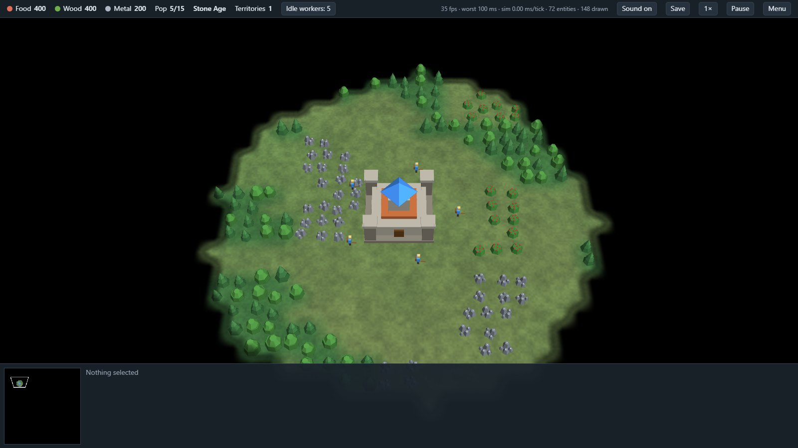

# OpenEpoch

**A free, open-source real-time strategy game spanning six epochs — from clubmen to nuclear submarines — that runs in your browser.**
The whole simulation is written in Rust and compiled to a 170 KB WebAssembly module with zero dependencies. 3D rendering, sound and peer-to-peer multiplayer are plain browser APIs: no engine, no bundler, no asset files.

### ▶ [Play it now](https://lukashold.github.io/openepoch/) &nbsp;·&nbsp; [Stress test: 4 000 units](https://lukashold.github.io/openepoch/?bench=2000)




## Why

Epoch-spanning RTS games of the early 2000s were wonderful, but big late-game battles — fleets, submarines, air wings — tended to stutter no matter how fast the PC was. OpenEpoch is a from-scratch take on that genre built around one goal: **thousands of units with flat frame times.**

Measured on the built-in stress test (`node tools/smoke.mjs`, one desktop core):

| Entities | Simulation cost per tick (20 ticks/s) |
|---------:|--------------------------------------:|
| 2 000 | ~0.9 ms |
| 4 000 | ~2.4 ms |
| 7 000 | ~5.6 ms |

A complete 3D frame with 4 000 units (simulation tick, instance upload, GPU) took 4–13 ms depending on zoom on an integrated AMD Radeon at 1400×850, i.e. about 60 fps without a dedicated graphics card.

How it stays smooth:

- **Fixed 20 Hz simulation, interpolated rendering.** The display rate never drives game logic, and a slow frame drops time instead of spiralling.
- **Shared flow fields instead of per-unit pathfinding.** A move order runs one BFS over the map; every unit heading there reads the same field. 500 units cost the same as 5.
- **No allocation in the tick.** Rust, fixed pools, no garbage collector — nothing to pause.
- **Uniform spatial grid** rebuilt by counting sort each tick for collision, targeting and splash damage; target searches are staggered across ticks.
- **One draw call per model type.** Rust writes a flat instance buffer, sorted by model, straight into WASM memory; JavaScript hands it to the GPU. No per-object JS calls, about 50 draw calls for any army size.
- **Multiplayer sends commands, not state.** Both browsers run the same deterministic simulation in lockstep, so a 4 000-unit battle needs the same few bytes per second as an empty map.

## The game

- **Six epochs:** Stone Age → Bronze Age → Middle Ages → Industrial Age → Modern Age → Atomic Age
- **43 units and buildings** across land, sea, air and underwater, all as procedurally generated low-poly 3D models on height-mapped terrain
- **Territories:** the map is divided into regions. A Town Center claims a free one; everything else can only be built on land you hold.
- **12 technologies** researched at the Town Center, Barracks, Workshop, Dock and Airfield (gathering, weapons and armour per unit class)
- **Transport ships** carry ten land units across the sea: right-click the ship to board, right-click a shore to land
- **Multiplayer 1 vs 1** (plus optional AI), peer to peer over WebRTC with no server
- **Save games** in the browser (Ctrl+S, autosave every three minutes, *Continue* in the menu)
- **Sound effects** synthesised at run time with WebAudio
- **Submarines** are invisible until a detector (destroyer, cruiser, gunship, tower, another sub) is nearby or they fire. **Nuclear submarines** torpedo ships and launch cruise missiles at targets far inland.
- **Aircraft** really fly: fixed-wing planes can't stop, make strafing and bombing runs, and loiter in circles; helicopters hover and hunt subs.
- **Economy:** food, wood, metal; workers gather, build, and go back to work afterwards; farms give endless food.
- **Fog of war**, minimap, control groups, attack-move, rally points, production queues, formations.
- **AI opponents** (1–3) that build an economy, advance through the epochs and attack in waves.
- **Procedural maps** from a seed — continents, lakes, forests, ore fields.

### Controls

| Input | Action |
|---|---|
| Left click / drag | Select · double-click selects all of a type · Shift adds |
| Right click | Move · attack · gather · build · set rally point |
| `A` + click | Attack-move |
| `S` / `Del` | Stop / destroy selected |
| Arrow keys, screen edge, middle-drag | Scroll |
| Mouse wheel | Zoom |
| `Q W E R T` / `Z X C V B` | Command buttons |
| `Ctrl+1…9` / `1…9` | Set / recall control group (tap twice to jump) |
| `F` · `H` · `Space` | Idle worker · home · jump to selection |
| `U` | Unload selected transport ships |
| `P` · `+` · `-` · `M` | Pause · game speed · sound on/off |
| `Ctrl+S` | Save (single player) |

### Multiplayer

Open the game in two browsers, choose **Multiplayer…** in the menu:

1. The host clicks **Host a game** and sends the invite code to the other player (chat, mail, anything).
2. The guest clicks **Join a game**, pastes it, presses **Create reply code** and sends that code back.
3. The host pastes the reply and presses **Connect**. The game starts on both sides.

There is no server in between, which also means the codes contain your network addresses (as with any WebRTC connection): only exchange them with the person you want to play with. Very strict firewalls or carrier-grade NAT can prevent a direct connection, because there is no relay.


## Build from source

```sh
rustup target add wasm32-unknown-unknown
./build.sh            # or .\build.ps1 on Windows
python -m http.server --directory docs 8123
```

Then open <http://localhost:8123>. No bundler, no npm install, no wasm-bindgen.

```
src/defs.rs     unit & building data
src/map.rs      map generation, passability, flow fields
src/game.rs     entities, orders, movement, combat, economy
src/ai.rs       scripted opponent
src/cmd.rs      player commands as data (the only way input reaches the simulation)
src/save.rs     save games
src/render.rs   instance buffer, minimap, HUD state
src/lib.rs      C-ABI exports called from the page
docs/main.js    3D WebGL2 renderer, camera, input, HUD, lobby
docs/models.js  procedural low-poly 3D models
docs/atlas.js   procedural 2D icons for the HUD
docs/audio.js   synthesised sound effects
docs/net.js     lockstep scheduler and WebRTC connection
tools/          headless tests and benchmark (Node)
```

URL parameters: `?seed=42` starts a skirmish on that map, `?ai=3` sets opponents, `?bench=2000` starts the stress test with 2 000 units per side.

### Tests

```sh
node tools/smoke.mjs       # AI game, build/research flow, save & load, lockstep determinism, benchmark
node tools/transport.mjs   # dock -> transport ship -> board -> unload
```

The lockstep test runs two copies of the simulation against each other over a simulated laggy link with random commands from both seats and checks that they never diverge.

## Status and roadmap

Playable skirmish against AI and 1 vs 1 multiplayer. Not there yet: music, more than two human players, a relay for networks that block direct connections, rejoining or saving multiplayer games, camera rotation, unit animation, upgrading existing units between epochs, AI use of transport ships, touch controls. Contributions welcome.

## Originality

OpenEpoch is an independent, original work. All code was written from scratch and every model, icon and sound is generated procedurally at start-up (`docs/models.js`, `docs/atlas.js`, `docs/audio.js`) — the repository contains no art, audio, data, names or code from any commercial game, and it is not affiliated with or endorsed by any game publisher.

## License

[MIT](LICENSE)
